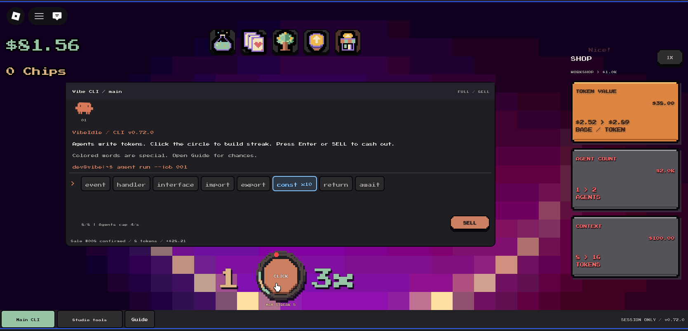
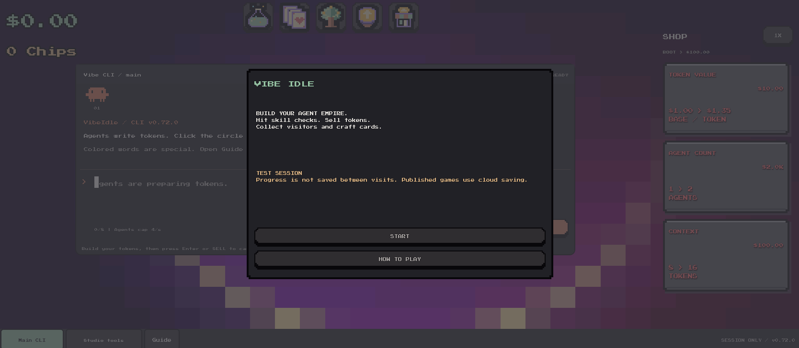
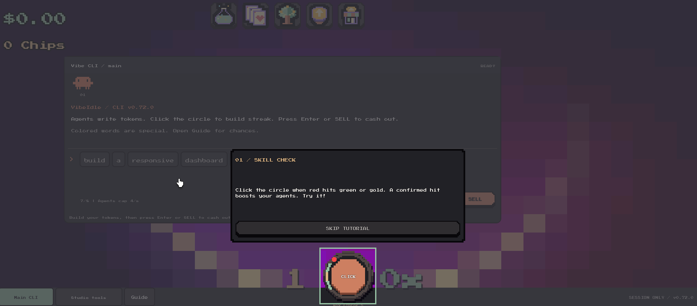
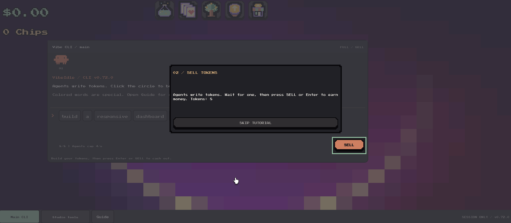

# VibeIdle

Jogo incremental no Roblox, desenvolvido em Luau, com uma interface de terminais
e agentes que produzem tokens dentro da economia do jogo. Os agentes são uma
mecânica simulada: o projeto não depende de APIs de inteligência artificial.

## Capturas do jogo

### Tela principal

Produção de tokens, skill check e loja de melhorias.



### Tela inicial

Menu de entrada e acesso ao tutorial.



### Tutorial de skill check

Orientação para acertar o momento do clique e obter bônus para os agentes.



### Tutorial de venda

Orientação para vender os tokens produzidos pelos agentes.



## Principais funcionalidades

- Interface interativa com tutorial, loja, coleção de cartas e árvore de habilidades.
- Regras de progressão e recompensas controladas pelo servidor.
- Validação de comandos, limitação de requisições e controle de ações repetidas.
- Persistência de perfis com migração de dados, salvamento periódico e proteção
  contra sessões concorrentes.
- Testes de regras e de comportamentos do cliente e servidor com serviços simulados.

## Abrir no Roblox Studio

1. Baixe o repositório e abra `build/VibeIdle.rbxlx` no Roblox Studio.
2. Inicie **Play** e selecione **START/CONTINUE**.
3. Use **HOW TO PLAY** ou **Guide** para consultar as regras e o tutorial.

No Studio, o modo padrão usa memória e não mantém o progresso entre visitas.
Os recursos de persistência em nuvem dependem de uma experiência publicada.
Compras com Robux ficam desativadas na configuração fornecida, com IDs zerados.

## Estrutura

```text
src/client/             Interface e controles do jogador
src/server/             Regras, persistência, telemetria e comércio
src/shared/             Estado, protocolo e regras compartilhadas
tests/                  Testes e serviços simulados
tools/                  Exportação, verificação e geração de recursos
assets/                 Catálogos e recursos visuais
docs/                   Documentação técnica
build/VibeIdle.rbxlx    Arquivo para abrir no Roblox Studio
default.project.json    Estrutura do projeto, compatível com Rojo 7
```

## Reconstruir o arquivo do jogo

Requer Python 3. Execute a partir da raiz do repositório:

```sh
python tools/build_place.py
```

O exportador usa a biblioteca padrão do Python e gera `build/VibeIdle.rbxlx`.

## Verificar o projeto

```sh
python tools/verify.py
```

O verificador prefere Luau CLI disponível no `PATH`. Há também um caminho
compatível com Lua 5.4 quando a biblioteca estiver disponível no ambiente.
Ele verifica recursos, fontes, exportação determinística e testes com serviços
simulados. Para verificar somente a estrutura e a exportação:

```sh
python tools/verify.py --structure-only
```

Os scripts opcionais de prévia usam Pillow. As prévias aproximam a geometria
da interface e não substituem uma captura ou validação no Roblox Studio.

## Documentação

- [Arquitetura](docs/ARCHITECTURE.md)
- [Testes e validações](docs/TESTING.md)
- [Persistência e revisão de lançamento](docs/LAUNCH_READINESS.md)
- [Métricas do jogo](docs/PLAYER_ANALYTICS.md)
- [Configuração de compras com Robux](docs/ROBux_SETUP.md)

Os testes com serviços simulados não comprovam funcionamento de DataStore,
Analytics ou Marketplace reais, nem desempenho e interação nativa no Studio.
